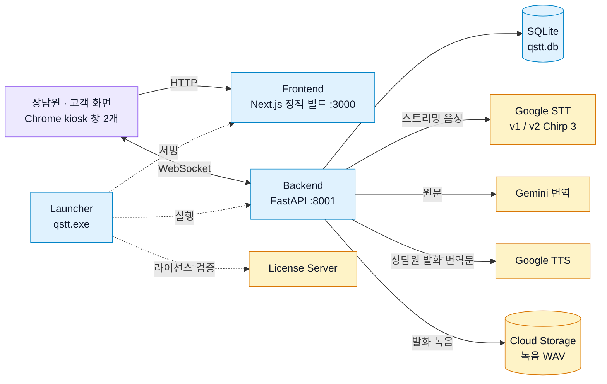

# 🌍 실시간 통역 시스템 (Real-time Translation System)

[English](README_eng.md) | **한국어**

한국 상담사와 외국인 고객 간의 실시간 음성 통역 서비스

---

## 🚀 빠른 시작

### Docker로 실행 (권장)

```powershell
# 1. 프로젝트 폴더로 이동
cd qstt

# 2. 자동 시작 스크립트 실행
.\docker-start.ps1
```

스크립트가 자동으로 환경 설정, Docker 빌드 및 실행을 진행합니다.

### 접속

- **Frontend**: http://localhost:3000
- **Backend API**: http://localhost:8001
- **API Docs**: http://localhost:8001/docs

## 🔑 필수 사항

### 1. Docker

- **Windows**: [Docker Desktop](https://www.docker.com/products/docker-desktop) 설치 후 실행
- 이 프로젝트는 **Docker Compose**로 백엔드·프론트를 함께 띄우는 흐름을 기준으로 합니다

### 2. Node.js (로컬 개발 시)

- **권장**: [Node.js LTS](https://nodejs.org/)
- 로컬에서 `npm install`, `npm run dev` 등을 쓸 때 필요합니다
- Docker만으로 실행하고 호스트에서 npm을 쓰지 않으면 생략 가능

### 3. Google Gemini API 키 (번역)

1. [Google AI Studio – API 키](https://aistudio.google.com/app/apikey)에서 키 발급
2. `.env`에 `GEMINI_API_KEY=` 로 저장

### 4. Google Cloud 자격 증명 JSON (STT / TTS)

1. [Google Cloud Console](https://console.cloud.google.com/)에서 프로젝트 선택 또는 생성
2. **Cloud Speech-to-Text API**, **Cloud Text-to-Speech API** 사용 설정
3. 서비스 계정을 만들고 **JSON 키**를 내려받기
4. `app_root/backend/credentials.json` 등에 두고, `.env`의 `GOOGLE_APPLICATION_CREDENTIALS`에 경로를 맞춤 (예: `credentials.json`)

**선택:** STT PhraseSet adaptation을 쓰는 경우에만 `GCP_STT_PHRASE_SET_REFERENCES`를 설정합니다. 비워 두어도 서버는 동작합니다.

---

## 🛠️ 기술 스택

- **Backend**: FastAPI + WebSocket + Python 3.11
- **Frontend**: Next.js 14 + TypeScript + Tailwind CSS
- **STT/TTS**: Google Cloud API
- **Translation**: Google Gemini API (`gemini-2.5-flash-lite`)
- **Recording**: Google Cloud Storage (발화 녹음 WAV)
- **Deployment**: Docker + Docker Compose / Windows 실행 파일 (pkg + PyInstaller)

---

## 🏗️ 시스템 구조



파란색은 고객 PC에서 실행되는 구성 요소, 주황색은 외부 서비스입니다.

- **상담원 · 고객 화면**: 같은 세션의 WebSocket에 연결됩니다. 한쪽이 말하면 STT → 번역 결과가 양쪽 화면에 동시에 표시됩니다.
- **TTS**: 상담원 발화에만 생성되며, 고객 화면에서 TTS가 켜져 있을 때 재생됩니다.
- **Launcher**: Windows 배포용 실행 파일입니다. 라이선스를 검증한 뒤 백엔드와 정적 프론트를 띄우고 Chrome kiosk 창 2개를 엽니다. 개발·Docker 실행에서는 사용하지 않습니다.

자세한 다이어그램:
- [시스템 구성도](docs/system_architecture.html) — 구성 요소별 역할과 배포 모드
- [음성 파이프라인 데이터 흐름](docs/data-flow-diagram.html) ([English](docs/data-flow-diagram_eng.html))

> GitHub에서는 HTML이 렌더링되지 않으므로 파일을 내려받아 브라우저로 열어 주세요.

---

## 📁 프로젝트 구조

```
qstt/
├── docker-compose.yml          # Docker 설정
├── docker-start.ps1            # 자동 시작 스크립트
├── docker-stop.ps1             # 자동 중지 스크립트
├── .gitignore
├── .env                        # 환경 변수 (생성 필요, Git 제외)
├── README.md
├── README_eng.md
├── docs/                       # 다이어그램·참고 문서
│   ├── data-flow-diagram.html
│   ├── data-flow-diagram_eng.html
│   ├── figma-vs-frontend-counselor-chat.md
│   └── system_architecture.html
└── app_root/
    ├── README.md
    ├── backend/
    │   ├── Dockerfile
    │   ├── main.py
    │   ├── requirements.txt
    │   ├── .dockerignore
    │   ├── README.md
    │   ├── start_server.ps1      # 로컬 실행 (동일 계열: .bat, .sh)
    │   ├── scripts/
    │   │   └── phrase_sets.py
    │   ├── services/
    │   │   ├── __init__.py
    │   │   ├── database.py
    │   │   ├── storage.py
    │   │   ├── translator.py
    │   │   ├── stt.py
    │   │   └── tts.py
    │   ├── credentials.json      # GCP 자격 (로컬, Git 제외)
    │   └── .env                  # Backend 환경 변수 (생성 필요, Git 제외)
    └── frontend/
        ├── Dockerfile
        ├── Dockerfile.dev        # 개발용 이미지
        ├── next.config.js
        ├── package.json
        ├── package-lock.json
        ├── postcss.config.mjs
        ├── tailwind.config.ts
        ├── tsconfig.json
        ├── README.md
        ├── .dockerignore
        ├── public/               # logo, worklets 등 정적 자산
        ├── scripts/              # Windows 런처 (qstt.exe)
        │   ├── chrome-launch-shared.js
        │   ├── launch-windows-stack.js
        │   ├── license-client.js
        │   ├── open-browsers.js
        │   ├── set-exe-windows-gui-subsystem.js
        │   └── write-launcher-expiry.js
        └── src/
            ├── app/
            ├── components/
            └── lib/
```


