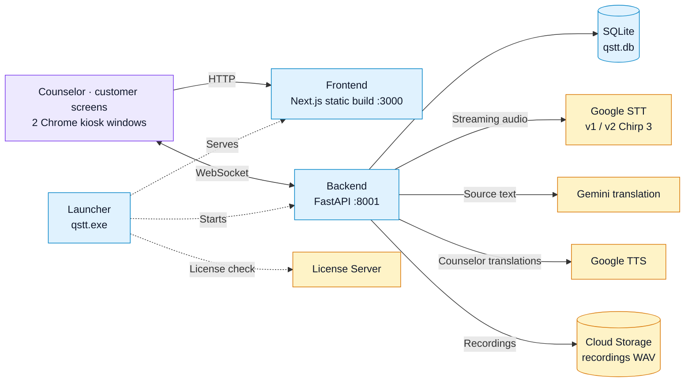

# 🌍 Real-time Translation System

**English** | [한국어](README.md)

A real-time voice interpretation service between Korean counselors and foreign customers.

---

## 🚀 Quick Start

### Run with Docker (recommended)

```powershell
# 1. Go to the project folder
cd qstt

# 2. Run the start script
.\docker-start.ps1
```

The script sets up the environment, then builds and starts the Docker containers.

### Endpoints

- **Frontend**: http://localhost:3000
- **Backend API**: http://localhost:8001
- **API Docs**: http://localhost:8001/docs

## 🔑 Requirements

### 1. Docker

- **Windows**: Install and run [Docker Desktop](https://www.docker.com/products/docker-desktop)
- This project assumes the backend and frontend are started together with **Docker Compose**

### 2. Node.js (for local development)

- **Recommended**: [Node.js LTS](https://nodejs.org/)
- Needed for `npm install`, `npm run dev`, etc. on your machine
- Not needed if you only run with Docker and don't use npm on the host

### 3. Google Gemini API key (translation)

1. Create a key at [Google AI Studio – API keys](https://aistudio.google.com/app/apikey)
2. Save it in `.env` as `GEMINI_API_KEY=`

### 4. Google Cloud credentials JSON (STT / TTS)

1. Select or create a project in the [Google Cloud Console](https://console.cloud.google.com/)
2. Enable **Cloud Speech-to-Text API** and **Cloud Text-to-Speech API**
3. Create a service account and download its **JSON key**
4. Place it at e.g. `app_root/backend/credentials.json` and point `GOOGLE_APPLICATION_CREDENTIALS` in `.env` to it (e.g. `credentials.json`)

**Optional:** Set `GCP_STT_PHRASE_SET_REFERENCES` only if you use STT PhraseSet adaptation. The server works without it.

---

## 🛠️ Tech Stack

- **Backend**: FastAPI + WebSocket + Python 3.11
- **Frontend**: Next.js 14 + TypeScript + Tailwind CSS
- **STT/TTS**: Google Cloud API
- **Translation**: Google Gemini API (`gemini-2.5-flash-lite`)
- **Recording**: Google Cloud Storage (utterance recordings as WAV)
- **Deployment**: Docker + Docker Compose / Windows executable (pkg + PyInstaller)

---

## 🏗️ System Architecture



Blue boxes run on the customer PC; orange boxes are external services.

- **Counselor and customer screens** connect to the same WebSocket session. When either side speaks, the STT and translation results appear on both screens.
- **TTS** is generated only for counselor speech and played on the customer screen when TTS is on.
- **Launcher** is the Windows distribution executable. It checks the license, starts the backend and the static frontend, and opens two Chrome kiosk windows. It is not used in development or Docker runs.

Detailed diagrams:
- [System architecture](docs/system_architecture.html) — role of each component and deployment modes (Korean)
- [Voice pipeline data flow](docs/data-flow-diagram_eng.html) ([한국어](docs/data-flow-diagram.html))

> GitHub does not render HTML files. Download them and open them in a browser.

---

## 📁 Project Structure

```
qstt/
├── docker-compose.yml          # Docker configuration
├── docker-start.ps1            # Start script
├── docker-stop.ps1             # Stop script
├── .gitignore
├── .env                        # Environment variables (create it; excluded from Git)
├── README.md
├── README_eng.md
├── docs/                       # Diagrams and reference docs
│   ├── data-flow-diagram.html
│   ├── data-flow-diagram_eng.html
│   ├── figma-vs-frontend-counselor-chat.md
│   └── system_architecture.html
└── app_root/
    ├── README.md
    ├── backend/
    │   ├── Dockerfile
    │   ├── main.py
    │   ├── requirements.txt
    │   ├── .dockerignore
    │   ├── README.md
    │   ├── start_server.ps1      # Local run (also .bat, .sh)
    │   ├── scripts/
    │   │   └── phrase_sets.py
    │   ├── services/
    │   │   ├── __init__.py
    │   │   ├── database.py
    │   │   ├── storage.py
    │   │   ├── translator.py
    │   │   ├── stt.py
    │   │   └── tts.py
    │   ├── credentials.json      # GCP credentials (local; excluded from Git)
    │   └── .env                  # Backend environment variables (create it; excluded from Git)
    └── frontend/
        ├── Dockerfile
        ├── Dockerfile.dev        # Development image
        ├── next.config.js
        ├── package.json
        ├── package-lock.json
        ├── postcss.config.mjs
        ├── tailwind.config.ts
        ├── tsconfig.json
        ├── README.md
        ├── .dockerignore
        ├── public/               # Static assets (logo, worklets, etc.)
        ├── scripts/              # Windows launcher (qstt.exe)
        │   ├── chrome-launch-shared.js
        │   ├── launch-windows-stack.js
        │   ├── license-client.js
        │   ├── open-browsers.js
        │   ├── set-exe-windows-gui-subsystem.js
        │   └── write-launcher-expiry.js
        └── src/
            ├── app/
            ├── components/
            └── lib/
```
